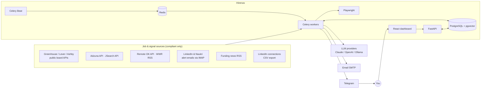
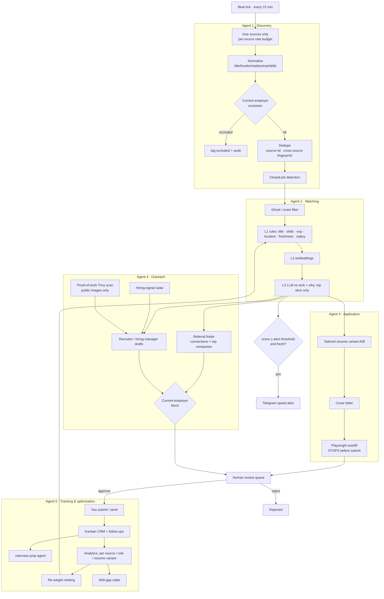
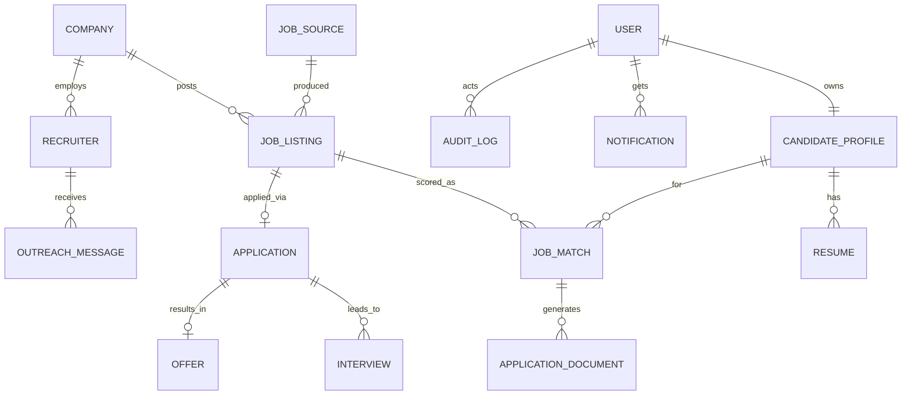

# Hirenza — Architecture

## 1. System context



## 2. Pipeline and agents



Agents are independent Celery tasks. They communicate only through database records
(`job_listings → job_matches → application_documents → applications …`), so any agent can
fail, retry or be re-run without breaking the others.

## 3. Code layout

```
backend/
  app/
    main.py                 FastAPI app, middleware, routers
    cli.py                  hirenza CLI (discover, score, top, skill-gaps …)
    core/                   config, db, security (JWT, argon2), logging, rate limits
    models/                 SQLAlchemy models
    schemas/                Pydantic request/response models
    api/routes/             auth, profile, jobs, sources, agents, insights, config, health
    guardrails/             current-employer exclusion (used by every agent)
    agents/
      discovery/sources/    one adapter per source (BaseSource interface)
      discovery/service.py  upsert, dedupe, closure detection
      matching/             skills vocab, scorer, ghost filter, service
      application/          resume tailoring, cover letters, playwright fillers   (phase 2-3)
      outreach/             recruiter, referral, signals, proof-of-work           (phase 4-6)
      tracking/             CRM, analytics, optimiser, interview prep             (phase 6-7)
    llm/                    provider abstraction + fallbacks                       (phase 2)
    notifications/          telegram, email, dispatcher (idempotent)
    workers/                celery app, beat schedule, tasks, locks
  alembic/                  migrations
  data/                     companies.yaml, profile.yaml (no personal contact data)
  tests/
frontend/                   React + TS + Tailwind                                  (phase 2+)
deploy/                     nginx, terraform, helm                                 (phase 10)
docker-compose.yml
.github/workflows/ci.yml
```

## 4. Data model (core)



Key constraints: `job_listings(source_id, external_id)` unique, `fingerprint` indexed for
cross-source dedupe, `job_matches(job_id, profile_id)` unique, `applications(profile_id, job_id)`
unique (duplicate-application block), `notifications(channel, dedupe_key)` unique (no repeat alerts),
`outreach_messages(recruiter_id, kind, sequence)` unique (no duplicate messages).

## 5. Reliability and safety

| Concern | Mechanism |
|---|---|
| Overlapping ticks | Redis lock per pipeline run; idempotent upserts |
| Source failure | Per-source try/except, failure counters, auto-disable dead boards, alert after 3 failures |
| Rate limits | Per-source minimum interval + request budget (e.g. Adzuna 2h, JSearch 12h) |
| LLM failure | Provider fallback chain → rule-based score still works |
| Approval | Submit/send endpoints require an `approved` state set by a human action |
| Confidentiality | `guardrails/` exclusion checked at discovery, outreach, referral and application |
| Secrets | `.env` only, `SecretStr`, never logged |
| Auth | JWT, argon2 hashing, login rate limit, audit log |
| Observability | JSON logs, `agent_executions` history, `/health` + `/health/ready`, Prometheus metrics (phase 10) |

## 6. Deployment

```
Zero-cost (now):     GitHub Actions cron → CLI pipeline → Neon Postgres → Gmail SMTP alerts
                     dashboard + Playwright run on the laptop during the daily review
Local / single VM:   docker compose → nginx · api · worker · beat · postgres · redis · frontend
AWS (portfolio):     Terraform → VPC · EKS · RDS Postgres · ElastiCache · S3 (resumes, backups)
                     Helm chart → api / worker / beat / frontend · Ingress (nginx) · cert-manager
CI/CD:               GitHub Actions → ruff · pytest · SonarQube · Snyk · OWASP DC · Trivy (fs+image)
                     → build & push image → helm upgrade (staging → manual approve → prod)
Monitoring:          Prometheus + Grafana dashboards (jobs/hour, source health, task failures)
```
